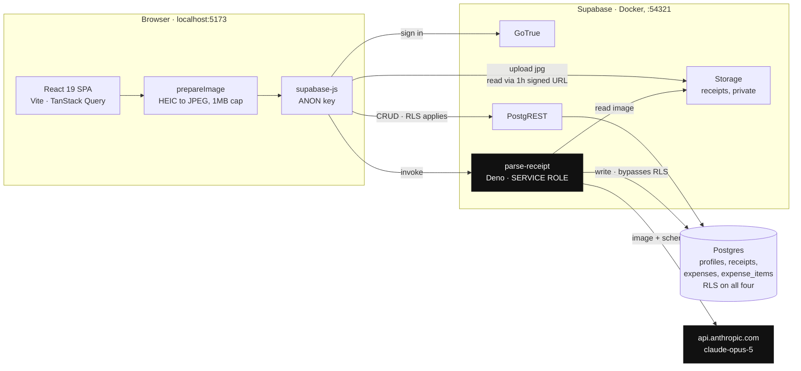
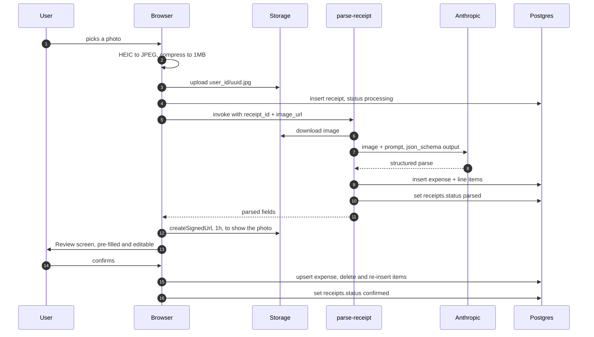

# FamilyLedger

A mobile-first receipt tracker. Photograph a receipt, Claude reads it, the expense lands in a dashboard.

Built for two people: a standard user who photographs receipts on her phone, and an admin who can see across accounts. The interface targets a 430px column and assumes the person using it is not technical — minimum 16px body text, 48px tap targets, no jargon.

---

## Architecture

Everything below is what the code actually does today — local only, nothing deployed.

The browser holds the **anon** key and is confined by row-level security. The **service role** key and the **Anthropic** key exist only inside the edge function. The two never meet: the browser uploads an image and asks for a parse, but it is the function that reads the image back out of storage and talks to Anthropic.



The two black nodes are the only places a privileged key exists. The browser's anon key can reach `rest`, `store` and `auth`, and nothing it holds can bypass row-level security.

### The parse path, step by step

The non-obvious part is that the image makes two trips: the browser puts it into storage, and the function fetches it back out. The browser never sends image bytes to the function — only a row id and a storage path.



If any step after the upload fails, the receipt row still exists, so the UI offers manual entry rather than losing the photo.

---

## Stack

| Layer | Choice |
|---|---|
| Frontend | React 19, TypeScript, Vite, Tailwind CSS 3 |
| UI primitives | shadcn/ui (Radix) |
| Data | TanStack Query 5 |
| Backend | Supabase — Postgres, Auth, Storage, Edge Functions |
| Receipt parsing | Claude Opus 5 vision, via a Deno edge function |
| Tests | Playwright (E2E) + a scored eval harness for OCR |

The edge function is TypeScript on Deno, not Node — it uses URL and `npm:` imports and `Deno.env.get()`.

---

## Running it locally

**Prerequisites:** Node 20+, Docker (or OrbStack), the [Supabase CLI](https://supabase.com/docs/guides/cli), and an Anthropic API key.

```bash
git clone https://github.com/alejandroderre-lang/familyledger.git
cd familyledger
npm install
```

**1. Start the local Supabase stack.** Migrations in `supabase/migrations/` apply automatically.

```bash
supabase start
```

**2. Point the app at it.** Copy the API URL and anon key printed by `supabase start`:

```bash
cp .env.example .env.local
# fill in VITE_SUPABASE_URL and VITE_SUPABASE_ANON_KEY
```

**3. Give the edge function an Anthropic key.**

```bash
echo 'ANTHROPIC_API_KEY=sk-ant-...' > supabase/.env
```

> `supabase start` does **not** read `supabase/.env`. Function secrets only load when you serve functions explicitly with `--env-file`, which is what the next step does.

**4. Run the app and the function.** Two terminals:

```bash
npm run dev
supabase functions serve --env-file supabase/.env
```

**5. Create a user.** There is no sign-up screen — accounts are created by an admin. Open Studio at `http://127.0.0.1:54323` → Authentication → Add user, tick *Auto Confirm*. To make someone an admin:

```sql
update public.profiles set role = 'admin' where email = 'you@example.com';
```

The app runs at `http://localhost:5173`.

---

## Testing

Two suites with different jobs.

### End-to-end (`npm run test:e2e`)

Playwright against a Pixel 7 viewport. **The receipt parse is mocked** — these assert the app's behaviour given a parse, never the quality of the parse. Deterministic, free, no API key needed.

```bash
npm run test:seed      # create/reset the local test accounts
npm run test:e2e       # 13 tests, ~25s
npm run test:e2e:ui    # interactive runner with a timeline
npm run test:e2e:headed  # watch it drive a visible browser
```

### OCR evals (`npm run test:evals`)

Uploads each synthetic receipt to storage, calls the **real** edge function, and scores the result field by field against known-good values. Money compares to the cent; descriptions case-insensitively. This is the only thing that tests recognition quality.

```bash
npm run test:evals
```

Ten fixtures covering comma decimals, separate quantity rows, weighed items, a printed total that exceeds the item sum, `CHANGE` lines that must not be read as the total, negative discount lines, multi-buy savings, German receipt vocabulary, a formal A4 invoice, a hotel folio, and an 18-item receipt.

> **These fixtures are synthetic HTML renders** — flat, evenly lit, perfectly square. They say nothing about real phone photos with glare, curl, shadow, motion blur, or perspective skew. A passing eval run means no regressions on clean renders, not that the OCR handles real-world photographs.

Regenerate the fixture images after editing `tests/fixtures/receipts.ts`:

```bash
npm run fixtures:generate
```

---

## Design directions

The dashboard is currently rendered in one of three interchangeable directions, all built in Ramp's register — hairline rules rather than shadows, tabular figures, near-monochrome, one accent spent sparingly.

| Direction | Character |
|---|---|
| `ledger` | One bordered metric strip split by hairlines; greyscale bars where rank is carried by weight |
| `statement` | Near-black hero with the month total reversed out; lime accent used twice |
| `grid` | Four-cell metric grid; category hues at a third of pill saturation |

Switch with `?design=ledger` (or `statement` / `grid`), or the temporary control above the bottom navigation. **That switcher is scaffolding** — remove `DesignSwitcher` once a direction is chosen.

Only the dashboard has been reworked. Upload, Review and Profile still carry the original card treatment.

---

## Layout

```
src/
  components/
    dashboard/     MetricStrip, CategoryBars, RecentExpenses
    expenses/      ExpenseRow, filters, line-item editor
    layout/        AppShell, BottomNav
    ui/            shadcn primitives
  design/          design directions + the hook that applies them
  hooks/           useAuth, useExpenses, useReceipts
  lib/             Supabase client, formatters, expense maths
  pages/           one per route
supabase/
  migrations/      001 schema · 002 storage · 003+004 role grants
  functions/
    parse-receipt/ the vision call (Deno)
tests/
  e2e/             Playwright specs
  evals/           scored OCR runs against the live model
  fixtures/        synthetic receipts + expected parses
```

### Migrations worth knowing about

`001` is the schema from the spec. The other three exist because Supabase's hosted dashboard state never made it into version control, so a rebuilt backend was missing pieces:

- **002** — the `receipts` storage bucket and its RLS policies
- **003** — table grants for `authenticated`. RLS filters rows a role may already touch; without the grant every request fails with `permission denied`
- **004** — the same grants for `service_role`, which the edge function uses to write parsed expenses

---

## Security notes

- `anon` has no table privileges. Authenticated users reach only their own rows via RLS.
- Admin checks go through a `security definer` helper (`public.is_admin()`) so the policy on `profiles` doesn't recurse into itself.
- `ANTHROPIC_API_KEY` is only ever read server-side in the edge function. It is never exposed to the browser.
- `.env`, `.env.local` and `supabase/.env` are gitignored.

---

## Known gaps

- **Not deployed.** Runs locally only; the original hosted Supabase project was deleted. Spec targets Vercel + hosted Supabase.
- **Real-photo OCR is untested.** See the eval caveat above.
- **The design rework stops at the dashboard.**
- **The design switcher ships in the UI** and should be removed once a direction is settled.
